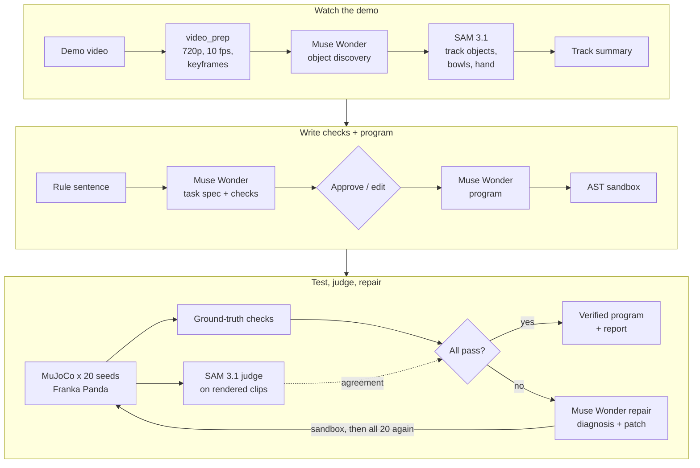

# Show & Tell Robotics

**Show a robot a task once on video, state the rules in one sentence, and get back a robot program
verified on 20 randomized scenes in simulation.**

Show & Tell is test-driven robot programming. It is built to use Meta's models to turn a phone
video of a person sorting objects plus one sentence ("Sort by size, and don't touch the glass.")
into pass/fail checks and a short robot program.

**Live demo:** [show-and-tell-robotics.vercel.app](https://show-and-tell-robotics.vercel.app) replays two recorded runs in the browser (no
backend): a task-6 run where one test scene fails, Muse Wonder diagnoses it and the patched program
passes 20/20, and a task-3 run from a stand-in video.

**Status:** the human demo videos are not filmed yet. So far the video path has run only on a
rendered stand-in clip (a top-down render of the robot doing task 3), and the benchmark's video
condition has not run (every video entry in `bench/results.json` is `missing_video`).

The program is tested on 20 randomized MuJoCo scenes with a Franka Panda arm. Simulator ground truth
grades every scene and decides pass/fail; in full runs (`run` and the web app, judge on by default)
SAM 3.1 also grades each scene from the rendered camera clips, and the report shows how often the two
agree. The benchmark's sentence-only condition is graded by ground truth only. Failures come back
with a one-line diagnosis and a patched program, for up to 3 repair rounds; a program that still
fails is reported as not verified.

## How it works

1. **Watch** — SAM 3.1 tracks the hands, objects and bowls in the demo video; we summarize what moved
   where, in what order.
2. **Write the checks** — Muse Wonder turns the track summary + keyframes (or the video) + the sentence
   into a task spec: attribute rules and checks from a closed vocabulary (`in_bin`, `untouched`,
   `upright`, `unmoved`). You approve or edit it.
3. **Write the program** — Muse Wonder writes `def run(scene)` that composes tested skills (`pick`,
   `place`, `avoid`, `move_to`) and selects objects by attribute, never by coordinates. An AST
   whitelist sandbox rejects anything else.
4. **Test** — the program runs in MuJoCo on 20 seeded layouts.
5. **Judge** — (a) simulator ground truth, (b) SAM 3.1 on the rendered overhead and 45° clips (on by
   default; off in the benchmark's sentence-only condition). We log how often they agree; ground
   truth decides.
6. **Repair** — on any failure, Muse Wonder gets the failed checks, any program error, the contact log
   (which object touched what, during which skill step) and 8 frames of the first failing scene,
   explains the failure in one sentence and patches the program. All 20 scenes rerun; at most 3
   repairs.
7. **Verified** — 20/20 gives you the program, a test report and the full attempt log.



## Meta models used

| Model | Where | What it does |
|---|---|---|
| **Muse Wonder** (`muse-wonder-1.0`) | `showtell/perception/track_summary.py`, `agent/spec.py`, `agent/program.py`, `agent/repair.py` | Discovers object kinds in keyframes; writes the task spec from video/keyframes + track summary + sentence (structured JSON output); writes the program; diagnoses failures from checks, contact logs and frames and patches the program. |
| **SAM 3.1** (`sam-3.1`) | `showtell/meta/sam.py`, `perception/track_summary.py`, `verify/judge_sam.py` | Tracks each object concept, the bowls and the hand through the demo video; when the judge is on (the default for `run` and the web app, off in the benchmark's sentence-only condition) it independently judges each rendered test scene from its overhead and 45° clips, using only SAM's boxes plus fixed scene knowledge (camera calibration, bin positions, object sizes). |

All calls go through the OpenAI-compatible Meta Model API (`https://api.meta.ai/v1`, Responses API),
are cached on disk by request hash (reruns cost $0) and are logged to `data/usage.jsonl`
(`python -m showtell cost`).

## Results

<!-- bench:start -->
| Task | First try (video) | Final (video) | Repairs | Final (sentence only) | Judge agreement | Cost $ | Time |
|---|---|---|---|---|---|---|---|
| task01_size | no video | no video | — | 20/20 | — | 0.05 | — |
| task02_color | no video | no video | — | 20/20 | — | 0.05 | — |
| task03_size_glass | no video | no video | — | 0/20 | — | 0.08 | — |
| task04_clear | no video | no video | — | 20/20 | — | 0.06 | — |
| task05_shape | no video | no video | — | 20/20 | — | 0.04 | — |
| task06_color_exc | no video | no video | — | 0/20 (1 repair) | — | 0.14 | — |

Pass rates are k/20 randomized scenes, scored against each task's reference checks (bench/tasks.yaml), which encode what each task's demo video shows (the shot list in bench/videos/README.md): a run can pass every check in the spec it generated and still score lower here. First try = the first generated program; Final = after up to 3 repairs (sentence-only repairs in brackets). Sentence only = the same pipeline without the demo video and without the SAM judge (simulator ground truth only). "no video" = the human demo video for the task is not recorded yet, so the video condition has not run. Judge agreement = SAM 3.1 on the rendered clips vs simulator ground truth (video condition). Cost $ = list price of the Meta API calls each run made, summed over the conditions that ran; responses served from the local cache are counted at list price but billed $0. Repairs and Time = the video condition.

Own checks vs reference checks:

- task03_size_glass (sentence only): 20/20 on its own checks, 0/20 on the reference checks.
- task06_color_exc (sentence only): 20/20 on its own checks, 0/20 on the reference checks.

Updated 2026-10-31 15:51:13.
<!-- bench:end -->

Every number above is generated by `bench/run_bench.py` from `bench/results.json`.

## Setup

Python 3.11+ (check `python3 --version`: macOS's own `/usr/bin/python3` is 3.9, too old), Node
20.19+ (the web app uses Vite 7), ffmpeg. From the repo root:

```bash
python3 -m venv .venv && source .venv/bin/activate
pip install -r requirements.txt && pip install -e .
git clone --filter=blob:none --no-checkout https://github.com/google-deepmind/mujoco_menagerie third_party/mujoco_menagerie
git -C third_party/mujoco_menagerie sparse-checkout set franka_emika_panda
git -C third_party/mujoco_menagerie checkout b0655057a9df2abe39ea7fc989914ba6f248301c
cp .env.example .env
```

The Menagerie lines fetch only the Franka Panda model (about 45 MB instead of the whole 2.3 GB
repository) at the commit the Dockerfile pins. Then edit `.env`: set `MODEL_API_KEY`, and set
`MUJOCO_GL=cgl` on macOS (`egl` with a GPU, `osmesa` on CPU-only Linux).

Run the tests (offline, about 2 minutes; `python -m pytest -q -m slow` runs the physics gate):

```bash
python -m pytest -q
```

Check the API (Wonder text/JSON/video, SAM tracking):

```bash
python -m showtell smoke
```

## Use it

Full pipeline on a demo video (`bench/videos/task03_size_glass.mp4` is not in the repo yet: film it as
described in `bench/videos/README.md`, or pass your own clip and `--task`):

```bash
python -m showtell run --video bench/videos/task03_size_glass.mp4 --rules "Sort by size, and don't touch the glass."
```

The same task from the sentence alone (the ablation):

```bash
python -m showtell run --task task03_size_glass --no-video --rules "Sort by size, and don't touch the glass."
```

Test a hand-written program on 20 seeds (no API needed):

```bash
python -m showtell run-program examples/size_sort.py --task task03_size_glass
```

Render a seeded scene from all three cameras:

```bash
python -m showtell render-scene --seed 1
```

Benchmark (both conditions, resumable):

```bash
python -m showtell bench
```

Web app (upload → approve spec → live 20-scene grid → attempts → report). Start the backend and the
frontend in two terminals from the repo root, then open http://localhost:5173. Terminal 1, the
backend on port 8000 (uvicorn is in the virtualenv):

```bash
source .venv/bin/activate && uvicorn showtell.api.app:app --timeout-graceful-shutdown 3
```

Terminal 2, the frontend on port 5173:

```bash
cd web && npm install && npm run dev
```

Leave `--reload` off: each job writes its program under `data/jobs/`, and a reload would restart the
server and end the running job.

Demo mode replays recorded runs with no backend: `python -m showtell export-demo --job <id>` writes
the run into `web/public/demo/`, and `VITE_DEMO=1 npm run dev` in `web/` (the default on Vercel)
replays it.

Docker (backend, CPU rendering):

```bash
docker build -t showtell . && docker run -p 8000:8000 --env-file .env -e MUJOCO_GL=osmesa -e SHOWTELL_DATA_DIR=/data -v showtell-data:/data showtell
```

The two `-e` flags keep the image's OSMesa rendering and data volume when your `.env` was written for
macOS (`MUJOCO_GL=cgl`) or copied from `.env.example`. Requests from outside the container are not
local, so set `SHOWTELL_API_TOKEN` in `.env`; POST requests then need `Authorization: Bearer <token>`.
Jobs that would call the paid API are refused (not started) once the spend logged in the container's
own `usage.jsonl` reaches `SHOWTELL_BUDGET_USD`; a running job is not stopped.

## Repo layout

```
showtell/
  meta/          Meta Model API client, files, Muse Wonder JSON calls, SAM 3.1 tracking + parsing, usage/cost
  sim/           MJCF scene (Panda + table + bins), seeded layouts, skills + IK, ground-truth checks, rendering
  perception/    video normalization + keyframes, SAM tracks -> track summary
  agent/         schemas, prompts, spec, program, AST sandbox, repair
  verify/        parallel seed runner, SAM judge, agreement
  pipeline.py    end-to-end orchestration with streamed events
  api/           FastAPI + SQLModel + background jobs + SSE + demo export
web/             Vite + React + TypeScript + Tailwind app (live and demo mode)
bench/           tasks.yaml (with reference checks), run_bench.py, videos/
examples/        hand-written programs (Phase 2 gate, reference programs for every task)
docs/            submission.md (hackathon write-up), demo_script.md (demo video shot list)
tests/           pytest (offline; `-m slow` runs the physics gate)
```

## Why naive programs fail (honestly)

The 20 cm glass is taller than the default 0.12 m transit height and is placed between the pick area
and the bins on the straight path from at least one object to a bin. A program that does not pass
`avoid=glass` really sweeps the carried block or the hand through it: in the Phase 2 gate the
hand-written size sort without `avoid` knocked the glass over on 19/20 seeds (`untouched` and
`upright` both failed), and with `avoid` it passed 20/20. Both runs need no API:
`python -m showtell run-program examples/size_sort_naive.py --task task03_size_glass --no-record`
(and the same with `examples/size_sort.py`). Nothing is scripted: no failure is injected, and
pass/fail always comes from the simulator.

What Muse Wonder actually does here: its first program on task 3 avoids the glass on every move
(`avoid(glasses)`, then `avoid=glasses` on every `pick` and `place`), and even when the sentence never
mentions the glass it adds untouched/upright checks for fragile objects and avoids them. So far every
first program on task 3 has passed its own checks on all 20 scenes without touching the glass (the
sentence-only run still scores 0/20 in the table above because its spec reversed the bins: small →
left). The first real repair came on task 6 in the benchmark's sentence-only condition (no demo
video): the first program avoided the blue cubes, and on one of 20 layouts (seed 6004) the detour
around a blue cube was out of the arm's reach, so the program stopped before placing anything
(19/20). Wonder read the failure report and 8 frames of that scene ("Avoiding the blue cubes forced
an unreachable over-the-blue waypoint while carrying the red cube, aborting the program before
placement."), dropped `avoid` for the short cubes, and the patch passed all 20 scenes against its
spec. Written without the video, that spec sends green to the middle bin, while the reference (what
the human demo is to show, `bench/tasks.yaml`) sends it to the right bin, so the table above scores
the same program 0/20: the gap the video is meant to close.

## Limitations

- Simulation only. Grasping uses a kinematic attach (no finger-contact physics); collisions of the
  carried object and the arm are real.
- Top-down grasps of rigid blocks, cylinders and a glass; three bins; one arm.
- Checks come from a closed vocabulary (`in_bin`, `untouched`, `upright`, `unmoved`).
- `avoid` picks its detour waypoint without checking reachability. On task 6 (seed 6004) that stopped
  the first program with an IK error; it is left as is so benchmark outcomes are not tuned after the
  fact.
- VERIFIED means the program passes the approved spec's checks on 20 seeded scenes, so it is only as
  right as the spec. Written from the sentence alone, task 3's spec reversed the bins and task 6's
  sent green to the middle bin (0/20 against the reference).
- No human demo video has been processed yet; the video path has only run on a rendered stand-in
  clip.
- Next: a real-arm pilot that runs the verified program on a physical Panda.
