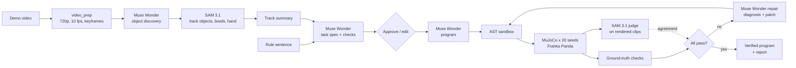

# Show & Tell Robotics

**Show a robot a task once on video, state the rules in one sentence, and get back a robot program
that is proven to work in simulation.**

Show & Tell is test-driven robot programming. Meta's models turn a phone video of a person sorting
objects plus one sentence ("Sort by size, and don't touch the glass.") into pass/fail checks and a
short robot program. The program is tested on 20 randomized MuJoCo scenes with a Franka Panda arm.
Two independent judges grade every scene. Failures come back with a one-line diagnosis and a patched
program, until all 20 pass.

## How it works

1. **Watch** — SAM 3.1 tracks the hands, objects and bowls in the demo video; we summarize what moved
   where, in what order.
2. **Write the checks** — Muse Wonder turns the track summary + keyframes (or the video) + the sentence
   into a task spec: attribute rules and checks from a closed vocabulary (`in_bin`, `untouched`,
   `upright`, `unmoved`). You approve or edit it.
3. **Write the program** — Muse Wonder writes `def run(scene)` that composes tested skills (`pick`,
   `place`, `avoid`, `move_to`) and selects objects by attribute, never by coordinates. An AST
   whitelist sandbox rejects anything else.
4. **Test** — the program runs in MuJoCo on 20 seeded layouts.
5. **Judge** — (a) simulator ground truth, (b) SAM 3.1 on the rendered overhead and 45° clips. We log
   how often they agree; ground truth decides.
6. **Repair** — on any failure, Muse Wonder gets the failed checks, the contact log ("the hand touched
   the glass during place(left_bin)") and 8 frames of the first failing scene, explains the failure in
   one sentence and patches the program. All 20 scenes rerun; at most 3 repairs.
7. **Verified** — 20/20 gives you the program, a test report and the full attempt log.



## Meta models used

| Model | Where | What it does |
|---|---|---|
| **Muse Wonder** (`muse-wonder-1.0`) | `showtell/perception/track_summary.py`, `agent/spec.py`, `agent/program.py`, `agent/repair.py` | Discovers object kinds in keyframes; writes the task spec from video/keyframes + track summary + sentence (structured JSON output); writes the program; diagnoses failures from checks, contact logs and frames and patches the program. |
| **SAM 3.1** (`sam-3.1`) | `showtell/meta/sam.py`, `perception/track_summary.py`, `verify/judge_sam.py` | Tracks each object concept, the bowls and the hand through the demo video; independently judges every rendered test scene from camera pixels only. |

All calls go through the OpenAI-compatible Meta Model API (`https://api.meta.ai/v1`, Responses API),
are cached on disk by request hash (reruns cost $0) and are logged to `data/usage.jsonl`
(`python -m showtell cost`).

## Results

<!-- bench:start -->
| Task | First try (video) | Final (video) | Repairs | Final (sentence only) | Judge agreement | Cost $ | Time |
|---|---|---|---|---|---|---|---|
| task01_size | no video | no video | — | 20/20 | — | 0.05 | — |
| task02_color | no video | no video | — | 20/20 | — | 0.05 | — |
| task03_size_glass | no video | no video | — | 0/20 | — | 0.08 | — |
| task04_clear | no video | no video | — | 20/20 | — | 0.06 | — |
| task05_shape | no video | no video | — | 20/20 | — | 0.04 | — |
| task06_color_exc | no video | no video | — | 0/20 | — | 0.14 | — |

Pass rates are k/20 randomized scenes, scored against each task's reference checks (bench/tasks.yaml). First try = the first generated program; Final = after up to 3 repairs. Sentence only = the same pipeline without the demo video. Judge agreement = SAM 3.1 on the rendered clips vs simulator ground truth. Cost covers both conditions at list price.

Updated 2026-10-31 15:51:13.
<!-- bench:end -->

Every number above is generated by `bench/run_bench.py` from `bench/results.json`.

## Setup

Python 3.11+, Node 20+, ffmpeg.

```bash
python3.11 -m venv .venv && source .venv/bin/activate
pip install -r requirements.txt && pip install -e .
git clone --depth 1 https://github.com/google-deepmind/mujoco_menagerie third_party/mujoco_menagerie
cp .env.example .env   # then set MODEL_API_KEY; MUJOCO_GL=cgl on macOS, egl (GPU) or osmesa (CPU) on Linux
```

Check the API (Wonder text/JSON/video, SAM tracking):

```bash
python -m showtell smoke
```

## Use it

Full pipeline on a demo video:

```bash
python -m showtell run --video bench/videos/task03_size_glass.mp4 --rules "Sort by size, and don't touch the glass."
```

The same task from the sentence alone (the ablation):

```bash
python -m showtell run --task task03_size_glass --no-video --rules "Sort by size, and don't touch the glass."
```

Test a hand-written program on 20 seeds (no API needed):

```bash
python -m showtell run-program examples/size_sort.py --task task03_size_glass
```

Render a seeded scene from all three cameras:

```bash
python -m showtell render-scene --seed 1
```

Benchmark (both conditions, resumable):

```bash
python -m showtell bench
```

Web app (upload → approve spec → live 20-scene grid → attempts → report):

```bash
uvicorn showtell.api.app:app --reload        # backend on :8000
cd web && npm install && npm run dev         # frontend on :5173
```

Demo mode replays recorded runs with no backend: `python -m showtell export-demo --job <id>`
writes `web/public/demo/`, and `VITE_DEMO=1 npm run dev` (the default on Vercel) replays it.

Docker (backend, CPU rendering): `docker build -t showtell . && docker run -p 8000:8000 --env-file .env showtell`.
Requests from outside the container are not local, so set `SHOWTELL_API_TOKEN` in `.env`; POST requests
then need `Authorization: Bearer <token>`. Jobs that would call the paid API stop at
`SHOWTELL_BUDGET_USD` of logged spend.

## Repo layout

```
showtell/
  meta/          Meta Model API client, files, Muse Wonder JSON calls, SAM 3.1 tracking + parsing, usage/cost
  sim/           MJCF scene (Panda + table + bins), seeded layouts, skills + IK, ground-truth checks, rendering
  perception/    video normalization + keyframes, SAM tracks -> track summary
  agent/         schemas, prompts, spec, program, AST sandbox, repair
  verify/        parallel seed runner, SAM judge, agreement
  pipeline.py    end-to-end orchestration with streamed events
  api/           FastAPI + SQLModel + background jobs + SSE + demo export
web/             Vite + React + TypeScript + Tailwind app (live and demo mode)
bench/           tasks.yaml (with reference checks), run_bench.py, videos/
examples/        hand-written programs (Phase 2 gate, reference programs for every task)
tests/           pytest (offline; `-m slow` runs the physics gate)
```

## Why naive programs fail (honestly)

The 20 cm glass is taller than the default 0.12 m transit height and is placed between the pick area
and the bins on the straight path from at least one object to a bin. A program that does not pass
`avoid=glass` really sweeps the carried block or the hand through it: in Phase 2 the hand-written
size sort without `avoid` knocked the glass over on 19/20 seeds, and with `avoid` it passed 20/20.
Nothing is scripted: no failure is injected, and pass/fail always comes from the simulator.

What Muse Wonder actually does here: its first program on task 3 calls `avoid(glass)` on every move,
and even when the sentence never mentions the glass it adds untouched/upright checks for fragile
objects and avoids them. So far task 3 has passed on the first try every time. The first real repair
came on task 6 ("blue things stay where they are"): the first program avoided the blue cubes, and on
one of 20 layouts the detour over a blue cube was out of the arm's reach, so the program stopped before
placing anything. Wonder read the failure report and frames ("Avoiding the blue cubes forced an
unreachable over-the-blue waypoint while carrying the red cube, aborting the program before
placement."), dropped the detour for the short cubes, and the patch passed 20/20.

## Limitations

- Simulation only. Grasping uses a kinematic attach (no finger-contact physics); collisions of the
  carried object and the arm are real.
- Top-down grasps of rigid blocks, cylinders and a glass; three bins; one arm.
- Checks come from a closed vocabulary (`in_bin`, `untouched`, `upright`, `unmoved`).
- Next: a real-arm pilot that runs the verified program on a physical Panda.
